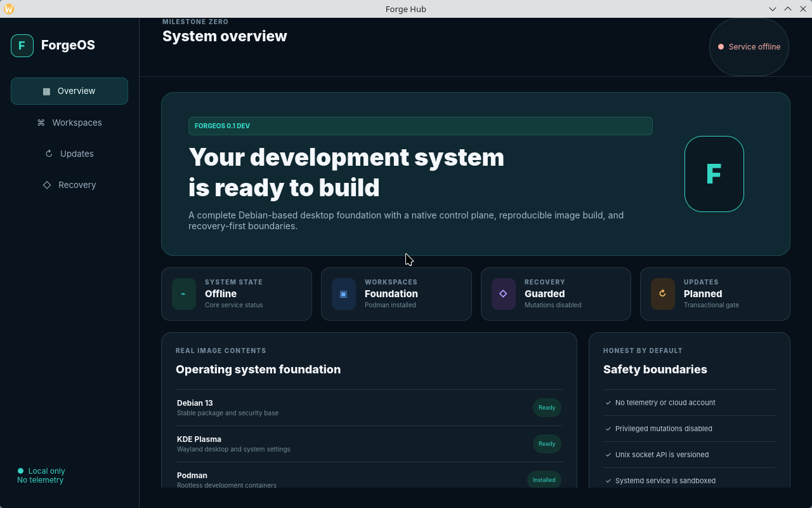
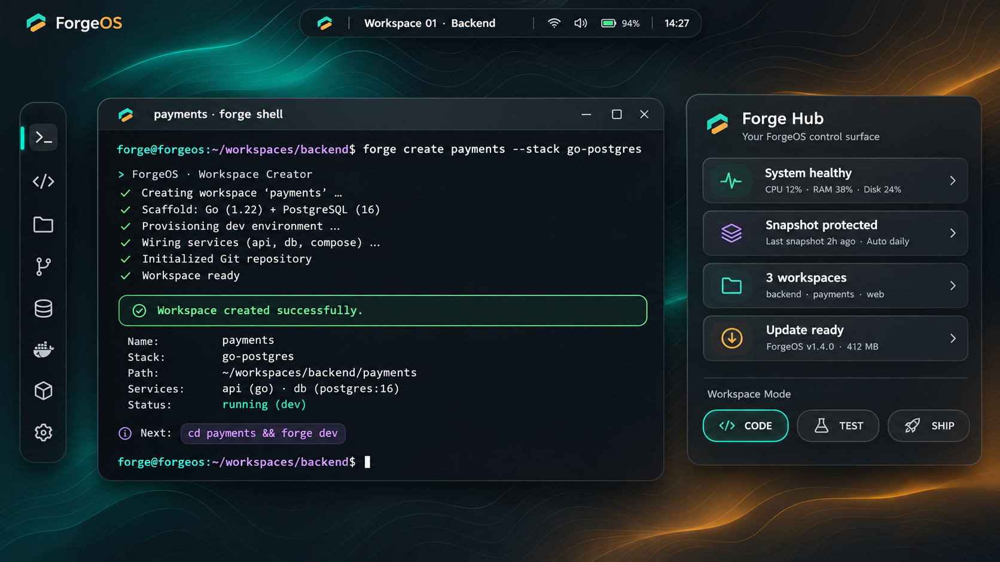

# ForgeOS

ForgeOS is a developer-focused Linux distribution built from Debian Stable. Its goal is to make backend development reproducible, privileged operations understandable, and operating-system recovery visible instead of mysterious.

This repository implements milestone zero from the ForgeOS product and engineering blueprint. It is an honest foundation rather than a claim that a production operating system is already finished.

## What works today

- A Debian `live-build` recipe for an x86-64 hybrid BIOS/UEFI KDE Plasma live image.
- Branded system identity, first-boot defaults, package selection, and desktop launcher.
- A native GTK 4 Forge Hub control center that talks to the local Unix-socket API.
- A small Go control service with a typed, versioned read-only API over a Unix socket.
- A matching `forge` CLI with human-readable and JSON output.
- Unit tests, configuration checks, GitHub Actions, and an ISO build workflow.
- Architecture, security, build, roadmap, and screenshot documentation.

## Architecture

```text
KDE Plasma / Forge Hub / forge CLI
                 |
        versioned local API
                 |
              forged
                 |
      systemd + Polkit boundary
                 |
  Debian / Btrfs / Podman / APT
```

The current daemon is deliberately read-only. The blueprint requires privileged mutations to be named, typed, authorized, auditable, and recoverable. Snapshot, update, repair, and installer mutations will only be added after the API, threat model, and QEMU fault tests are in place.

## Quick start

### Run the core service on Linux

```bash
go test ./...
go build -o bin/forged ./cmd/forged
go build -o bin/forge ./cmd/forge
sudo ./bin/forged --socket /run/forgeos/forged.sock
./bin/forge status
./bin/forge status --json
```

### Build the live ISO

Use Debian 13 or a Debian-based Linux VM with `live-build` installed:

```bash
sudo apt update
sudo apt install live-build debootstrap squashfs-tools xorriso isolinux syslinux-common
sudo ./scripts/build-iso.sh
```

The ISO will be written to `.build/forgeos-amd64.hybrid.iso`. See [docs/BUILDING.md](docs/BUILDING.md) for the full workflow.

## Verified native interface



This is an implementation screenshot captured automatically after booting the checksum-verified ISO in QEMU. It shows the native GTK 4 Forge Hub shipped in the image, not a webpage or browser mockup. The offline service badge exposed a live-user socket permission issue; the socket policy has since been corrected and the next image build is gated by the same boot-proof workflow.

## Interface design reference



The image above is the original design reference. The repository ships its native GTK 4 implementation at `config/includes.chroot/usr/bin/forge-hub`; the earlier browser prototype has been removed.

## Project boundaries

- Version 0.1 targets UEFI x86-64 only.
- ForgeOS reuses Debian, the upstream Linux kernel, systemd, KDE Plasma, Podman, Flatpak, Btrfs, and LUKS2.
- It does not create a new kernel, package manager, init system, compositor, or container runtime.
- Snapshots are recovery points, not backups.
- No usage telemetry or cloud account is required.

## Documentation

- [Architecture](docs/ARCHITECTURE.md)
- [Build and test guide](docs/BUILDING.md)
- [Implementation status](docs/STATUS.md)
- [Roadmap](ROADMAP.md)
- [Security policy](SECURITY.md)
- [Full product blueprint](Blueprint/ForgeOS%20Product%20and%20Engineering%20Blueprint.docx)

## License

MIT. Debian packages and third-party components retain their own licenses.

